<!DOCTYPE html>
<html>
<head>
  <meta name="viewport" content="width=device-width,initial-scale=1">
  <title>Wise Bee Nursery - Accra | Fruits, Vegetables, Flowers</title>
  
</head>
<body>

  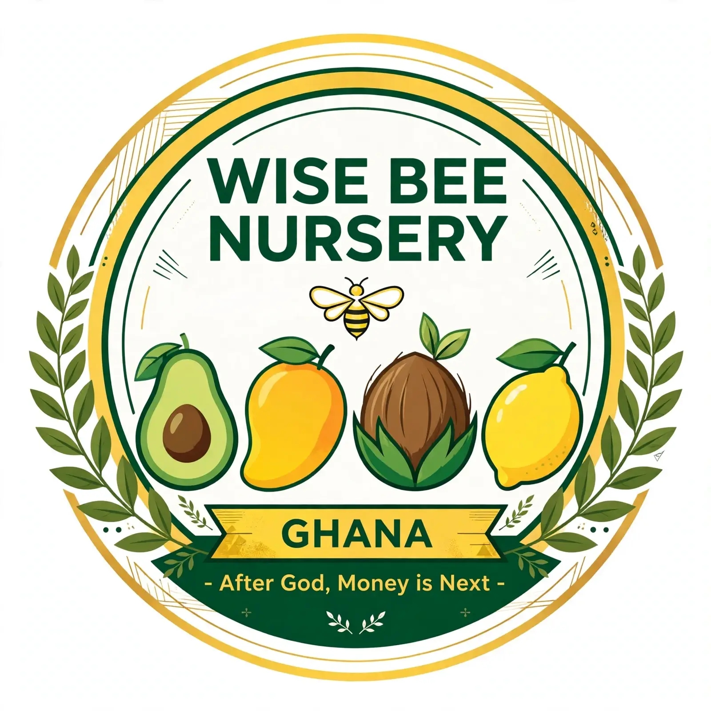
  <h1 style="margin:10px 0 5px">🌱 WISE BEE NURSERY 🐝</h1>
  
Accra, Ghana | +233 25 625 8697

  
Fruits • Vegetables • Flowers • All Grafted, Fruits in 2–3 Years

  
After God, Money is Next

  <a class="btn" style="background:#fff;color:#0a5c26" href="https://wa.me/233256258697?text=Hello%20Wise%20Bee%20Nursery,%20I%20want%20to%20buy%20seedlings">💬 Order on WhatsApp</a>

📸 Wise Bee Nursery Gallery

  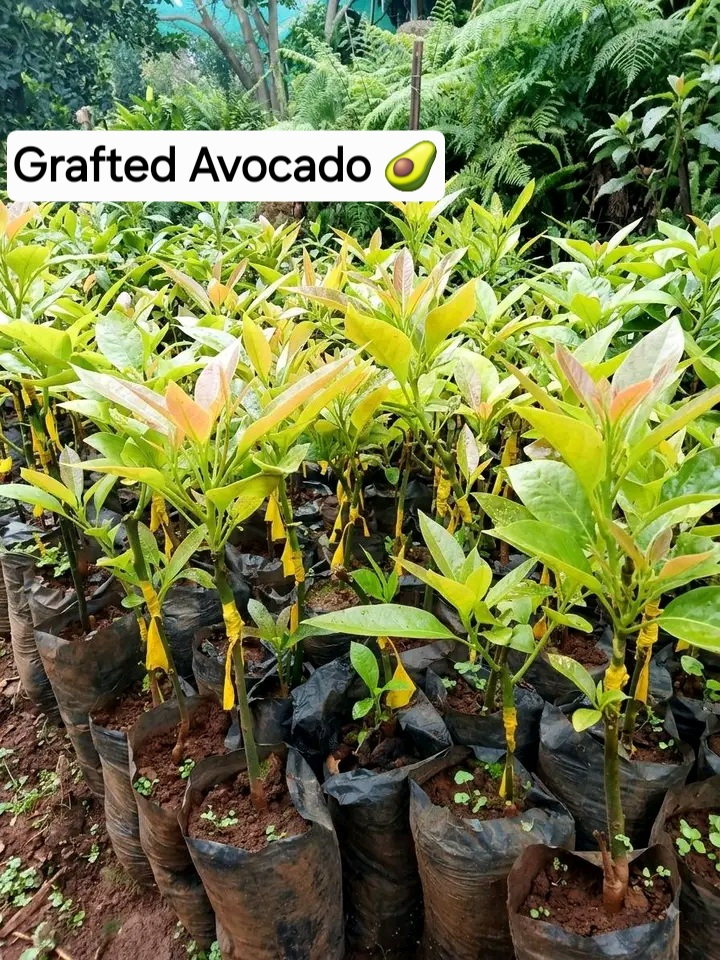
  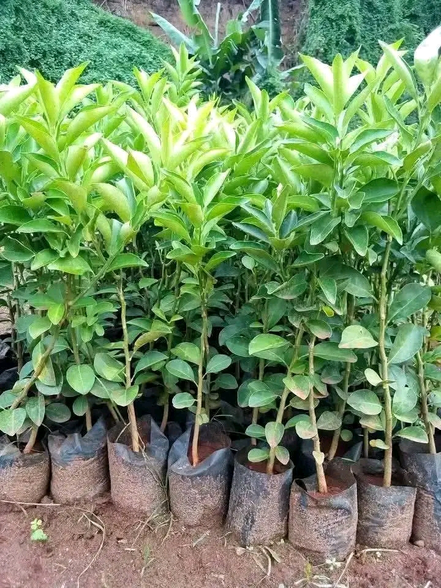
  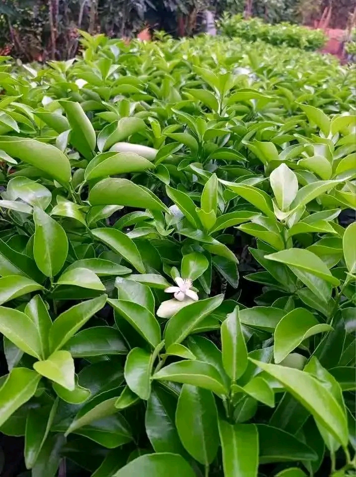
  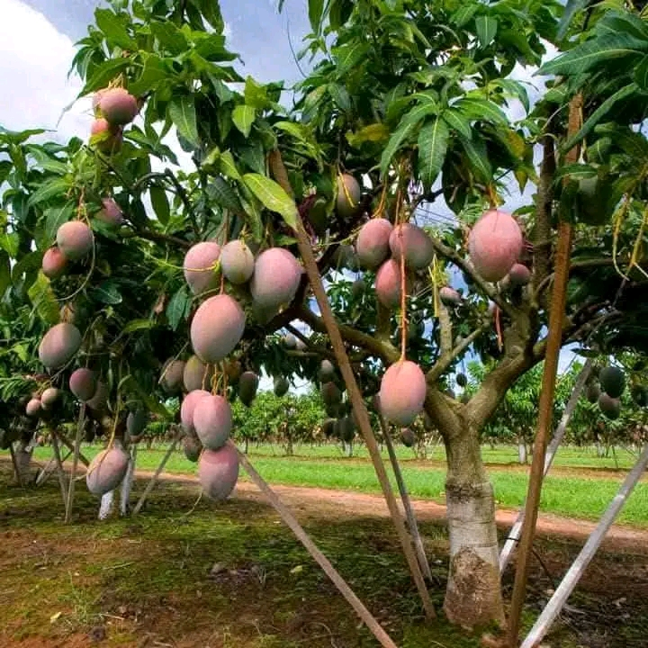
  
  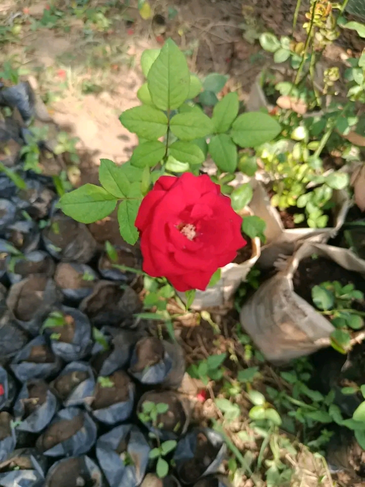

🥑 AVOCADO SEEDLINGS

  
  

    PREMIUM BEST SELLER - HASS
    <h2>Hass Avocado - Export Grade</h2>
    
GHS 50

    <a class="btn" href="https://wa.me/233256258697?text=I%20want%20Hass%20Avocado%20GHS50">Order Hass</a>
  

  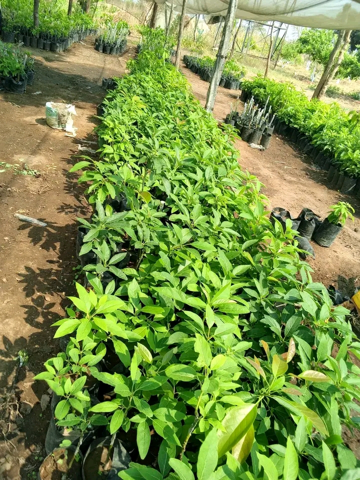
  

    <h2>Fuerte Avocado - Ghana Favorite</h2>
    
GHS 40

    <a class="btn" href="https://wa.me/233256258697?text=I%20want%20Fuerte%20Avocado">Order Fuerte</a>
  

  
  

    <h2>Booth 8 & Local Ghana Avocado</h2>
    
GHS 30–55

    <a class="btn" href="https://wa.me/233256258697?text=I%20want%20Booth%208%20Avocado">Order Booth 8</a>
  

🍊 ORANGE SEEDLINGS

  
  

    BEST FOR JUICE - VALENCIA
    <h2>Valencia, Navel & Blood Orange</h2>
    
GHS 30–40

    <a class="btn" href="https://wa.me/233256258697?text=I%20want%20Orange%20seedlings">Order Orange</a>
  

🍈 SOURSOP & 🍐 GUAVA

  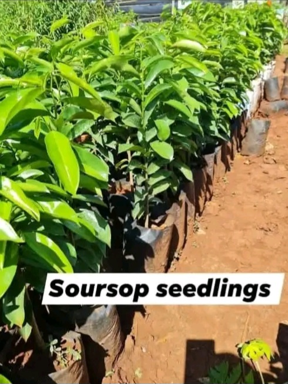
  

    <h2>Soursop Sweet & Giant + Guava White / Pink / Giant Thai</h2>
    
Soursop GHS 35–45 | Guava GHS 25–40

    <a class="btn" href="https://wa.me/233256258697?text=I%20want%20Soursop%20and%20Guava">Order Soursop & Guava</a>
  

🍋 OTHER FRUITS & VEGETABLES

  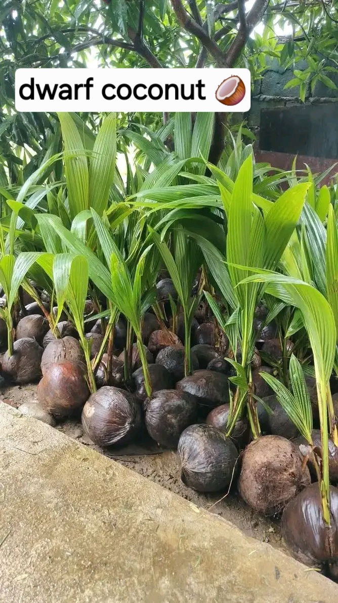
  

    <h2>All Type of Fruit Plants - Mango, Coconut, Lemon, Pawpaw etc.</h2>
    
From GHS 20 - GHS 90

    
Grafted seedlings - fruits in 1-2 years. Ask on WhatsApp for full list.

    <a class="btn" href="https://wa.me/233256258697?text=I%20want%20to%20see%20all%20fruit%20seedlings">Order Fruit Seedlings</a>
  

🌸🌺 FLOWER PLANTS - NEW SECTION

Beautiful indoor & outdoor flowers. From GHS 60 - GHS 200 depending on size / variety. All available in Accra - delivery nationwide.

  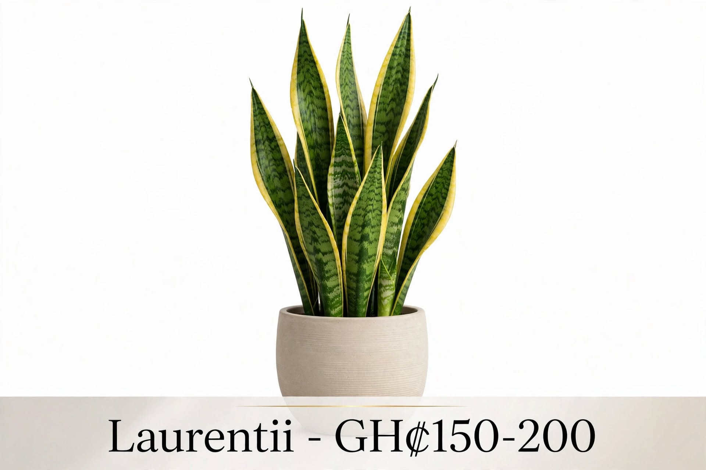
  

    BEST SELLER - INDOOR / OUTDOOR
    <h2>Laurentii - Snake Plant</h2>
    
Tall green leaves with yellow edges. Very strong, low water, cleans air. Perfect for home, office & veranda.

    
GHS 60 - GHS 120

    <a class="btn" href="https://wa.me/233256258697?text=I%20want%20Laurentii%20Snake%20Plant">Order Laurentii</a>
  

  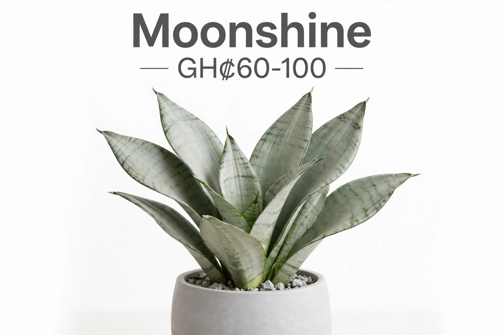
  

    PREMIUM - MOONSHINE
    <h2>Moonshine - Silver Snake Plant</h2>
    
Beautiful silver-green leaves. Same strong Snake Plant family as Laurentii, but lighter colour. Great indoor decoration.

    
GHS 80 - GHS 150

    <a class="btn" href="https://wa.me/233256258697?text=I%20want%20Moonshine%20Snake%20Plant">Order Moonshine</a>
  

  
  

    RARE - MONSTERA ALBO
    <h2>Monstera Albo - White Variegated</h2>
    
Rare Monstera with white + green leaves. Big beautiful leaves. For collectors & indoor decoration. Limited stock - ask first.

    
GHS 150 - GHS 200

    <a class="btn" href="https://wa.me/233256258697?text=I%20want%20Monstera%20Albo">Order Monstera Albo</a>
  

  
  

    <h2>Rose - Red, Pink, White & Yellow</h2>
    
Flowering roses for garden & pots. Sweet smell, blooms again and again.

    
GHS 60 - GHS 100

    <a class="btn" href="https://wa.me/233256258697?text=I%20want%20Rose%20plants">Order Rose</a>
  

  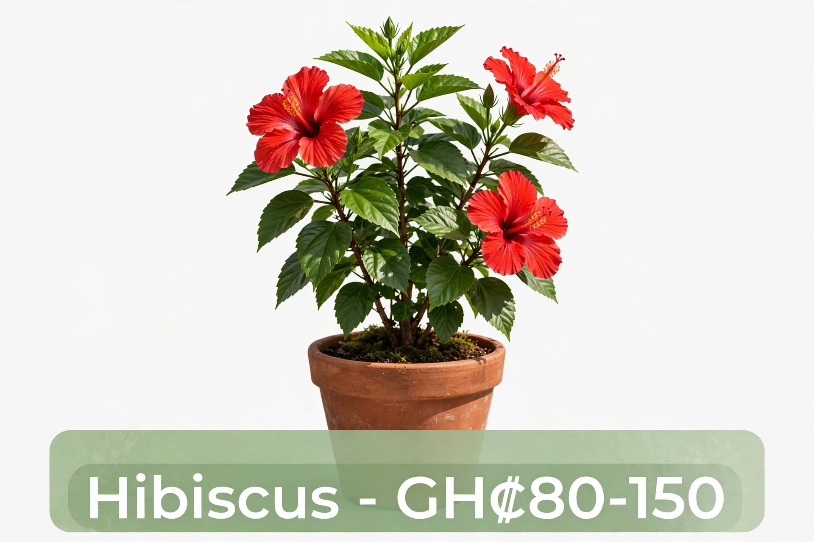
  

    <h2>Hibiscus - Hibiscus Flower Plants</h2>
    
Big bright flowers - red, pink, yellow & orange. Loves sun, flowers all year in Accra.

    
GHS 60 - GHS 100

    <a class="btn" href="https://wa.me/233256258697?text=I%20want%20Hibiscus%20plants">Order Hibiscus</a>
  

<h2>Orchid flower - Orchid flower</h2>

  
  

    <h2>All Flower Plants - Ask For Full List</h2>
    
Laurentii, Moonshine, Monstera Albo, Rose, Hibiscus + more. Send a photo of what you want on WhatsApp and we will find it.

    
Flower Plants From GHS 60 - GHS 200

    <a class="btn" href="https://wa.me/233256258697?text=I%20want%20to%20see%20all%20flower%20plants">Order All Flowers</a>
  

  <h2>Wise Bee Nursery Accra</h2>
  
📞 +233 25 625 8697 | Delivery in Accra & Nationwide

  
After God, Money is Next 🌱

  <a class="btn" style="background:#fff;color:#0a5c26" href="https://wa.me/233256258697">Chat on WhatsApp Now</a>

</body>
</html>
